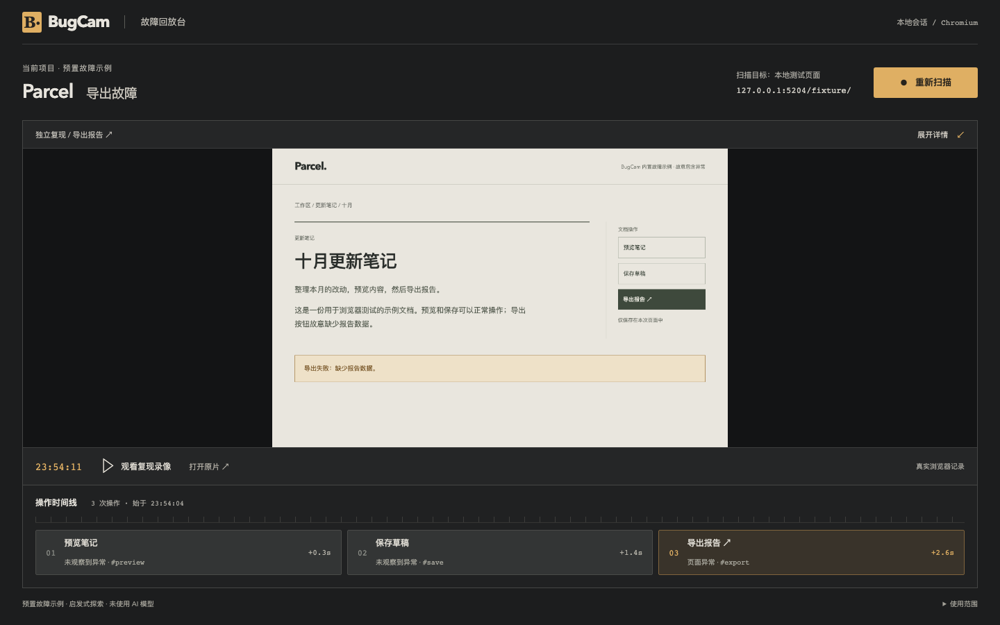
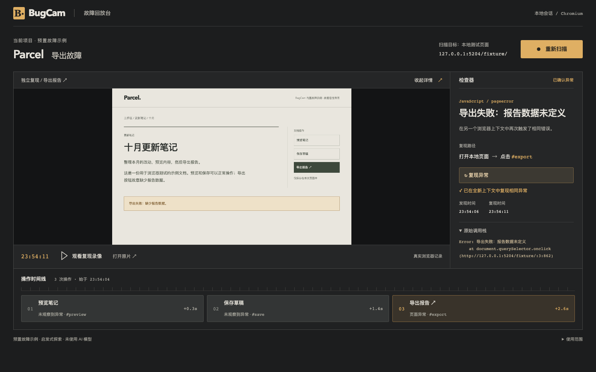

# BugCam

一个浏览器故障回放台。把一次点击、报错时的画面和调用栈放在一起，再开一个浏览器确认问题是否还会出现。



适合开发者或测试同学演示“这个按钮是怎么出错的”。目前只能运行仓库里的 Parcel 示例：预览和保存正常，导出故意报错。它还不能拿来扫描你的生产网站，也没有调用 AI 模型。

## 启动

需要 npm 和 Node.js `^22.12.0 || ^24.0.0 || >=26.0.0`。Node 23、25 不受支持。进入本项目目录后运行：

```sh
npm run setup
npm run doctor
npm run dev
```

打开 [127.0.0.1:4204](http://127.0.0.1:4204)。不需要账号或 API Key。停止服务时，在启动终端按 Ctrl+C。

`setup` 按锁文件安装依赖，再将 Chromium 无头浏览器和录像组件安装到项目内 `.browsers`，已有匹配版本会复用。npm 缓存在 `.npm-cache`。首次安装需要网络；脚本不会改全局配置或安装系统包。以上命令可在 macOS、Linux 和 Windows PowerShell 中使用，但目前只在 macOS 上实际验证过。

`doctor` 会检查 Node、依赖、浏览器能否启动，以及 4204 / 5204 端口。缺依赖或浏览器时重新运行 setup；若端口被自己启动的 BugCam 占用，先停止旧服务。Linux 缺少 Chromium 系统库时，需要自行准备支持 Playwright 的环境。

应用不自动读取 `.env`。通常不需要设置环境变量；若要复用其他兼容浏览器缓存，可设置 `PLAYWRIGHT_BROWSERS_PATH`。macOS / Linux 使用 `export PLAYWRIGHT_BROWSERS_PATH=/路径`，PowerShell 使用 `$env:PLAYWRIGHT_BROWSERS_PATH = '路径'`。setup 始终向本项目安装。

## 看一次导出失败

点击 **开始扫描**。真实 Chromium 会依次操作「预览笔记」「保存草稿」「导出报告」，完成的步骤出现在下方。点击某个步骤，就能查看那次操作留下的截图。

导出触发异常后，右侧显示「导出失败：报告数据未定义」。点击 **复现异常**，程序另开浏览器，重新点击导出并比对错误。成功时会显示独立复现结果和两次时间。



点击 **观看复现录像** 播放这次运行的视频；“显示截图”可以切回来。“收起详情”会把更多空间留给画面。手机上，时间线和错误详情排在画面下方；键盘 Tab 可找到“跳到开始扫描”。

这两张图片均由实际运行的应用截图生成，保存在仓库中。示例中的故障是预置的，但操作、异常检测、截图和录像都来自本次浏览器执行。

## 数据留在哪里

前端在 4204 端口，API 和内置页面在 5204 端口，只监听 `127.0.0.1`。健康检查是 [api/health](http://127.0.0.1:5204/api/health)，示例页面是 [fixture](http://127.0.0.1:5204/fixture/)。不要通过隧道把它暴露到公网。

每次运行的截图、WebM 录像和 `result.json` 存在 `artifacts/hunts/<运行 ID>/`。重启后，内存里的运行索引会清空，需要重新扫描；文件仍在，可停止服务后手动清理。它不读取用户凭据，也不上传录像。

扫描最多检查 8 个带安全 ID 的控件，只支持单击，限时 30 秒，另加浏览器关闭和保存证据的时间。同一时刻只能运行一个任务。只有另一个上下文捕获到相同页面异常才会确认问题；普通 console.error、请求失败或业务结果错误不算已确认缺陷。

## 开发与验证

前端是 React + TypeScript + Vite，本地 API 使用 Express，浏览器操作由 Playwright 1.59.0 执行。依赖的精确版本保留在 `package-lock.json`，请勿删除锁文件来处理安装问题。

停止开发服务后执行：

```sh
npm run doctor
npm run build
npm run test
npm run e2e
npm run demo
```

测试检查实际的三次点击、准确错误、独立运行 ID 和时间、视频可播放、步骤切换、详情展开收起、网络失败提示，以及桌面和手机布局。demo 会重新拍摄 README 的两张图片，并在 `artifacts/playwright/demo/` 留下真实界面录像。

本轮结果与证据引用见 [status.json](status.json)。验证环境是 macOS、Node 26.4.0；Windows、Linux、Node 22/24 和空缓存完整下载未实测。Node 26 上可选 trace 压缩曾超时，目前关闭 trace，截图和视频照常保留。AI 冲刺状态仍为 PARTIAL，因为当前实现使用启发式规则，没有模型推理。

MIT 许可证见 [LICENSE](LICENSE)。
